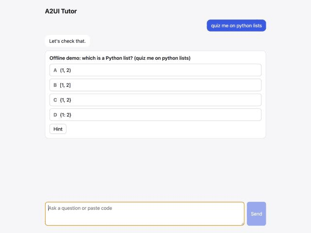

# a2ui-tutor

[](https://github.com/OWNER/a2ui-tutor/actions/workflows/ci.yml)

An interactive coding tutor on [A2UI v1.0](https://a2ui.org). The agent never answers with a wall of text. It answers
with **surfaces** built only from an approved custom catalog, and whatever the student presses goes back to the agent
and produces the next surface.



> The GIF was recorded with `TUTOR_OFFLINE=1`, a canned one-question quiz, because no Gemini key was available while
> building. The same UI path serves real Gemini output.

## Components (the whole catalog)

| Component | What the student does |
| --- | --- |
| `CodeBlock` | Reads highlighted code, selects a line, presses **Explain line** or **Run** |
| `Quiz` | Picks an option, gets instant right/wrong feedback, can ask for a hint |
| `PredictOutput` | Types what code prints, presses **Reveal** to compare |
| `StepWalkthrough` | Opens collapsible steps |
| `ProgressCard` | Sees topics mastered |

Plus the layout primitives `Text`, `Row`, `Column`, `Divider`. Nothing else can be drawn: see [architecture](docs/architecture.md).

## Quickstart

```bash
cp .env.example .env            # add GEMINI_API_KEY, or set TUTOR_OFFLINE=1
# agent
cd agent && python -m venv .venv && .venv/bin/pip install -e ".[dev]"
.venv/bin/uvicorn app.main:app --port 8000
# web, in a second terminal
cd web && npm install && npm run dev      # http://localhost:5173
```

Or `docker compose up --build` and open http://localhost:8080.

Checks (same as CI):

```bash
cd agent && .venv/bin/ruff check . && .venv/bin/pytest -q && .venv/bin/python -m app.catalog.build --check
cd web && npx tsc --noEmit && npx vitest run
cd agent && .venv/bin/python evals/run_eval.py     # 10 prompts against the configured model
```

## Design tradeoffs

- **Catalog as guardrail, not prompt.** The prompt asks for approved components; the validator enforces it. A reply
  with an `Image`, an unknown property or a 1-option quiz never reaches the renderer.
- **One JSON catalog, two consumers.** Python and TypeScript read the same generated file; CI catches drift.
- **Correct answers travel with the component.** Feedback is instant and offline-capable, at the cost that a curious
  student can read the answer from the wire. Fine for a tutor, wrong for an exam.
- **Code is never executed.** `Run` asks the agent to reason about output; `expectedOutput` comes from the model and
  can be wrong. Real execution would need a sandbox.
- **Direct JSON, not Express.** More tokens than the SDK's compact Express notation, but easier to read in logs and
  tests.
- **Non-streaming, in-memory sessions.** Simple and testable; a real deployment needs streaming and a session store.
- **Per-line highlighting.** Multi-line strings and comments can be mis-coloured; it keeps line selection trivial.

## Status and limits

Tests use a scripted fake LLM. **The live Gemini path has not been exercised**; run `evals/run_eval.py` with a key to
see how a real model behaves. The Docker images were not built in the authoring environment, only the compose file
was validated. See [docs/quickstart-notes.md](docs/quickstart-notes.md) for the official quickstart run.

MIT licensed.
