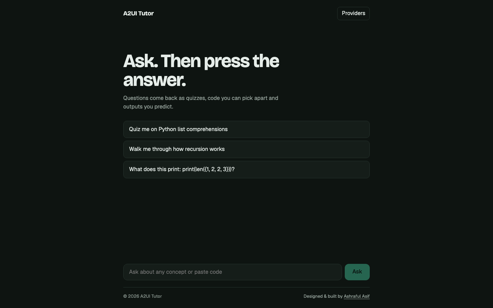
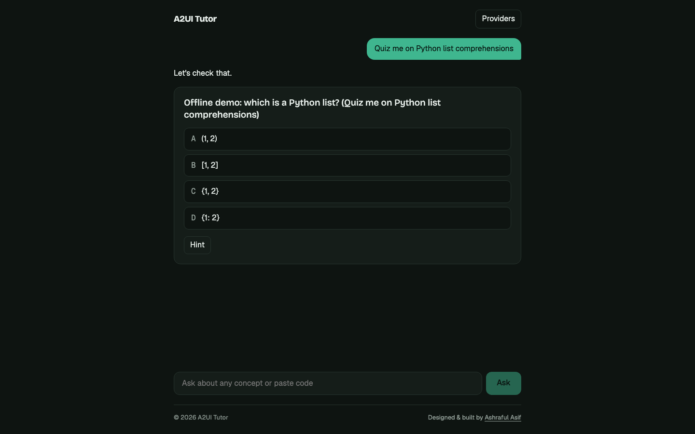
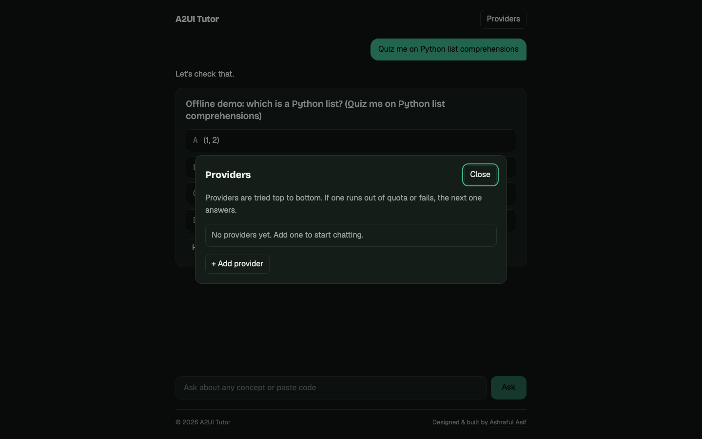
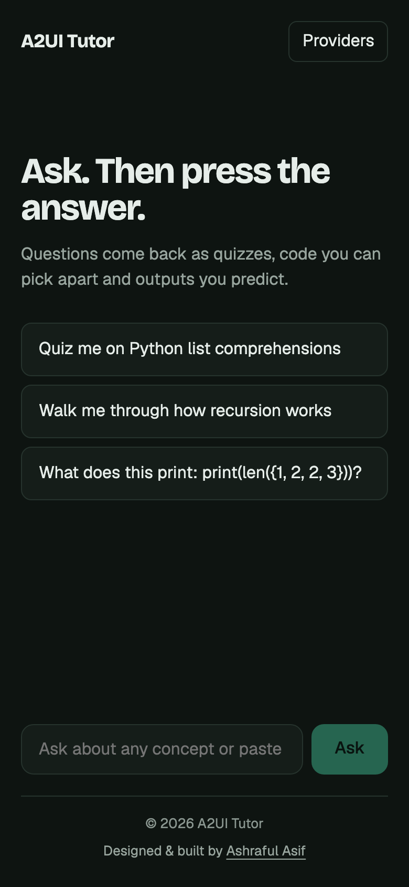

# A2UI Coding Tutor

[](https://python.org)
[](https://nodejs.org)
[](https://fastapi.tiangolo.com)
[](https://react.dev)
[](https://www.typescriptlang.org)
[](https://a2ui.org)
[](LICENSE)

An interactive, generative-UI coding tutor built on Google's **Agent-to-UI ([A2UI v1.0](https://a2ui.org))** standard. Instead of passive, wall-of-text explanations, the tutor generates rich, interactive UI **surfaces**—including quizzes, output prediction games, syntax-highlighted code blocks, and stepped walkthroughs—rendered natively in the browser. Every student interaction flows back to the agent to adaptively steer the next step in the learning journey.

---

## Overview & Key Features

### 🎓 Learner Experience & Interaction
- **A2UI v1.0 Protocol Native**: The tutor does not output raw markdown. Responses are structured A2UI protocol messages (`createSurface`, `updateComponents`, `dataModelUpdate`) validated against a strict component catalog.
- **5 Approved Custom Catalog Components**:
  - `Quiz`: Multiple-choice conceptual checks with client-side validation, instant feedback, and collapsible hints.
  - `CodeBlock`: Syntax-highlighted code snippets supporting interactive line selection, explanation requests, and simulated execution.
  - `PredictOutput`: Interactive code prediction challenges where learners reason through program state and submit predictions before revealing answers.
  - `StepWalkthrough`: Stepped, collapsible architectural and algorithmic walkthroughs designed for deep conceptual comprehension.
  - `ProgressCard`: Visual topic mastery checkpoints and learning progression summaries.
- **Zero-Token Offline Mode (`TUTOR_OFFLINE=1`)**: Built-in mock responder allows complete end-to-end testing, local demonstrations, and UI development without requiring active API keys or external LLM calls.
- **Responsive Modern Design**: Monospace typography accents, fluid layout scaling, full keyboard accessibility, dark aesthetic tokens, and mobile-optimized viewports.

### ⚙️ Multi-Provider AI Engine & Administration
- **Multi-LLM Provider Support**: Native integration with:
  - **Google Gemini** (`gemini-2.5-flash`, `gemini-2.0-flash`, `gemini-1.5-pro`)
  - **Anthropic Claude** (`claude-3-5-sonnet-20241022`, `claude-3-5-haiku`)
  - **OpenAI-Compatible Endpoints** (OpenAI `gpt-4o`, OpenRouter, Groq, DeepSeek, Ollama, LM Studio)
- **Automatic Fallback & Failover**: Configured providers are evaluated sequentially. If a provider encounters rate limits (HTTP 429), invalid keys, or network timeouts, it enters a temporary cooldown while the next active provider handles the request.
- **In-App Provider Management Modal**: Test connections, toggle providers on/off, reorder failover priorities, and dynamically query supported models directly from the UI.
- **Secure Local Storage**: API keys are saved locally on the host in `agent/data/providers.json` with restricted `0600` filesystem permissions and are masked before transmission across the API.

---

## Visual Tour & Screenshots

### 1. Public & Initial Interface
The welcoming interface greets learners with curated starter prompts, immediate input focus, and responsive styling.


*Initial tutor landing screen showing topic starter chips, clean typography, and creator attribution footer.*

---

### 2. Interactive A2UI Learning Surfaces
When a learner asks a question, the agent returns an A2UI surface populated with interactive components rather than static text.


*Active A2UI surface rendering an interactive Python list comprehension quiz with instant evaluation options, hint controls, and conversational dialogue.*

---

### 3. Provider Configuration & Admin Panel
Access the **Providers** modal from the header to configure, reorder, test, and toggle LLM providers with automatic failover.


*In-app provider settings modal showing active LLM backends, failover ordering, API key masking, and connection testing.*

---

### 4. Responsive Mobile Experience
The application is designed mobile-first, ensuring smooth interaction on smaller screens and mobile devices.

<p align="center">
  
</p>
<p align="center">
  <em>Mobile layout (390x844) maintaining full conversational flow, touch-friendly starter buttons, and adaptive card surfaces.</em>
</p>

---

## Tech Stack

| Domain | Technology | Description |
|---|---|---|
| **Frontend Framework** | [React 19](https://react.dev/) | Modern reactive component rendering |
| **Language (Web)** | [TypeScript 5.9](https://www.typescriptlang.org/) | Strict static typing and A2UI schema compliance |
| **Build Tool & Bundler** | [Vite 6](https://vite.dev/) | Fast HMR development server and optimized rollup production builds |
| **A2UI Client SDKs** | `@a2ui/react`, `@a2ui/web_core` | Official client-side A2UI surface message processors |
| **Syntax Highlighting** | [highlight.js](https://highlightjs.org/) | Per-line code block highlighting |
| **Backend Framework** | [FastAPI](https://fastapi.tiangolo.com/) (0.115+) | High-performance Python ASGI API framework |
| **ASGI Server** | [Uvicorn](https://www.uvicorn.org/) | Production-ready ASGI server |
| **Language (Agent)** | [Python 3.11+](https://www.python.org/) | Strongly typed async backend engine |
| **A2UI Agent SDKs** | `a2ui-agent-sdk`, `a2ui-core` | Agent-side A2UI surface generation and JSON catalog validation |
| **LLM Clients** | `google-genai`, `httpx` | Native SDKs and async HTTP adapters for OpenAI/Anthropic/Gemini |
| **Testing Suites** | [Pytest](https://pytest.org/), [Vitest](https://vitest.dev/), Testing Library | Unit, integration, and guardrail test suites |
| **Containerization** | [Docker](https://www.docker.com/), Docker Compose, Nginx | Multi-stage container builds and static frontend hosting |

---

## Project Structure

```text
.
├── LICENSE                      # MIT License
├── README.md                    # Project documentation & visual guide
├── docker-compose.yml           # Multi-container orchestration (agent + web)
├── humans.txt                   # Creator and developer attribution
├── .env.example                 # Example configuration template
│
├── agent/                       # Python Backend & A2UI Agent
│   ├── Dockerfile               # Production container definition for agent
│   ├── pyproject.toml           # Python dependencies, Ruff, and Pytest configuration
│   ├── app/
│   │   ├── main.py              # FastAPI application, routing, and lifecycle events
│   │   ├── tutor.py             # Tutor prompt orchestration, sessions, and catalog builder
│   │   ├── llm.py               # Multi-provider client abstraction (Gemini, Claude, OpenAI)
│   │   ├── providers.py         # Provider storage, failover logic, and testing
│   │   ├── catalog/             # A2UI catalog definitions and auto-generation
│   │   └── examples/            # Example A2UI payloads and mock fixtures
│   ├── data/                    # Local provider credentials (0600 permissions, gitignored)
│   ├── evals/                   # Automated evaluation prompts and regression harness
│   └── tests/                   # Pytest test suite (guardrails, catalog, providers, tutor)
│
├── docs/                        # Complete architecture & design documentation
│   ├── PRD.md                   # Product Requirements Document
│   ├── TRD.md                   # Technical Requirements Document
│   ├── USER_JOURNEY.md          # User journeys, interaction flows, and state maps
│   ├── architecture.md          # Protocol lifecycle and sequence diagrams
│   ├── design.md                # Design tokens, typography, and styling guidelines
│   ├── rules.md                 # Engineering guidelines and architectural guardrails
│   ├── schema.md                # Data schemas and persistence models
│   └── screenshots/             # Visual tour screenshots (1440x900 desktop & 390x844 mobile)
│
├── scripts/                     # Utility and screenshot automation scripts
│   └── capture-all.mjs          # Headless Chrome CDP script for screenshot generation
│
└── web/                         # React Frontend Application
    ├── Dockerfile               # Multi-stage production container build with Nginx
    ├── nginx.conf               # Nginx reverse proxy configuration for web container
    ├── package.json             # Frontend dependencies and npm scripts
    ├── vite.config.ts           # Vite configuration with /api reverse proxy
    ├── src/
    │   ├── main.tsx             # React application entry point
    │   ├── App.tsx              # Main chat interface, feed state, and modal controller
    │   ├── Providers.tsx        # Provider configuration panel and testing interface
    │   ├── api.ts               # Typed client API for /api/chat and /api/providers
    │   ├── styles.css           # Core styling, responsive layout, and design tokens
    │   └── catalog/             # Approved custom A2UI React component implementations
    │       ├── Quiz.tsx         # Quiz component with instant feedback
    │       ├── CodeBlock.tsx    # Code block with line selection and reasoning
    │       ├── PredictOutput.tsx# Interactive output prediction challenge
    │       ├── StepWalkthrough.tsx # Collapsible step breakdown
    │       └── ProgressCard.tsx # Topic completion tracking card
    └── test/                    # Vitest frontend test suite
```

---

## Prerequisites

Ensure your system meets the following requirements before local installation:

- **Node.js**: Version `20.0.0` or higher (LTS recommended)
- **npm**: Version `10.0.0` or higher
- **Python**: Version `3.11` or higher
- **Docker & Docker Compose** *(Optional)*: For containerized local development and deployment

---

## Getting Started

### 1. Clone Repository & Setup Environment

```bash
git clone https://github.com/OWNER/a2ui-tutor.git
cd a2ui-tutor

# Copy example environment configuration
cp .env.example .env
```

### 2. Configure Environment Variables

Edit `.env` to configure your initial model provider or enable zero-token offline mode:

| Variable | Required | Default | Description | Example |
|---|:---:|---|---|---|
| `GEMINI_API_KEY` | Optional | `""` | Seeds an initial Google Gemini provider on first launch. | `AIzaSy...` |
| `GEMINI_MODEL` | Optional | `gemini-3.5-flash` | Default Gemini model ID. | `gemini-2.5-flash` |
| `PROVIDERS_FILE` | Optional | `data/providers.json` | Relative path to local provider storage. | `data/providers.json` |
| `TUTOR_OFFLINE` | Optional | `0` | Set to `1` or `true` to run without API keys using canned mock surfaces. | `1` |

> 💡 **Tip:** If you do not have an API key right now, set `TUTOR_OFFLINE=1` in your `.env` to launch the tutor in offline mock mode immediately.

---

### 3. Backend Setup (`agent/`)

In a new terminal window:

```bash
cd agent

# Create and activate Python virtual environment
python3 -m venv .venv
source .venv/bin/activate

# Install dependencies in editable mode with development tools
pip install -e ".[dev]"

# Start the FastAPI agent server
uvicorn app.main:app --host 127.0.0.1 --port 8000 --reload
```

The backend server will start at `http://127.0.0.1:8000`. You can verify it via `curl http://127.0.0.1:8000/api/health`.

---

### 4. Frontend Setup (`web/`)

In a second terminal window:

```bash
cd web

# Install npm dependencies
npm install

# Start Vite development server (proxies /api to 127.0.0.1:8000)
npm run dev
```

Open your browser at `http://localhost:5173` to start learning with the A2UI Coding Tutor!

---

## Available Scripts & Commands

### Backend (`agent/`)

| Command | Description |
|---|---|
| `uvicorn app.main:app --port 8000 --reload` | Starts the local FastAPI development server with hot-reload. |
| `pytest -q` | Runs all backend unit, catalog, and provider tests. |
| `ruff check .` | Runs Ruff linter across the Python codebase. |
| `python -m app.catalog.build --check` | Verifies synchronization between Python catalog and A2UI schema. |
| `python evals/run_eval.py` | Runs evaluation benchmark prompts against the active model provider. |

### Frontend (`web/`)

| Command | Description |
|---|---|
| `npm run dev` | Starts Vite local development server with HMR at `http://localhost:5173`. |
| `npm run build` | Runs TypeScript type checking (`tsc --noEmit`) and Vite production build. |
| `npm run typecheck` | Validates TypeScript types across the frontend. |
| `npm test` | Runs the Vitest test suite (`vitest run`). |

---

## API Reference

The backend provides a clean REST API. Interactive Swagger documentation is automatically available at `http://127.0.0.1:8000/docs`.

### Core Endpoints

#### Health Check
```http
GET /api/health
```
- **Response**: `{"status": "ok"}`

#### Chat Interaction
```http
POST /api/chat
```
- **Request Body**:
  ```json
  {
    "sessionId": "b6a8f152-4468-45d6-848e-6705db8a49c2",
    "message": "Quiz me on Python list comprehensions"
  }
  ```
- **Response**:
  ```json
  {
    "text": "Let's check your understanding of list comprehensions.",
    "messages": [
      {
        "createSurface": {
          "surfaceId": "s1",
          "catalogId": "a2ui-tutor-catalog-v1"
        }
      }
    ],
    "surfaceId": "s1",
    "provider": "Google Gemini (gemini-2.5-flash)"
  }
  ```

#### Provider Management
- `GET /api/providers`: Returns list of configured providers with masked keys and status.
- `POST /api/providers`: Add a new provider (`name`, `format`, `baseUrl`, `apiKey`, `modelId`).
- `PUT /api/providers/order`: Update failover priority order.
- `PUT /api/providers/{pid}`: Update provider settings or toggle active state.
- `DELETE /api/providers/{pid}`: Delete a provider.
- `POST /api/providers/{pid}/test`: Send a test probe to verify provider credentials and connectivity.
- `POST /api/providers/models`: Discover available models for a given API key and base URL.

---

## Deployment

### Docker Compose (Recommended)

The repository includes a ready-to-use `docker-compose.yml` that builds both the Python agent and the Nginx-hosted static React application:

```bash
# Build and run the entire stack
docker compose up --build -d
```

- **Web Frontend**: Access via `http://localhost:8080` (bound to `127.0.0.1:8080`).
- **Agent API**: Internal communication handled automatically over Docker network.

To stop the containers:
```bash
docker compose down
```

### Production Build Manually

To produce an optimized production bundle for static hosting:

```bash
cd web
npm run build
```

The output artifacts will be written to `web/dist/`, ready to be served by Nginx, Caddy, Cloudflare Pages, or Vercel.

---

## Architecture & Design Docs

For in-depth architectural decisions, protocol workflows, and data models, consult the documentation in [`docs/`](docs/):

- 📖 **[PRD.md](docs/PRD.md)**: Product Requirements, user personas, problem space, and success criteria.
- 📐 **[TRD.md](docs/TRD.md)**: Technical Architecture, component catalog schemas, and failover design.
- 🗺️ **[USER_JOURNEY.md](docs/USER_JOURNEY.md)**: Interaction pathways, step transitions, and user recovery states.
- 🎨 **[design.md](docs/design.md)**: Design system tokens, color palettes, and component states.
- ⚖️ **[rules.md](docs/rules.md)**: Non-negotiable engineering principles and catalog invariants.
- 🏗️ **[architecture.md](docs/architecture.md)**: Sequence diagrams and protocol mechanics.

---

## Contributing

Contributions are welcomed! Please follow these steps:

1. Fork the repository and create a feature branch (`git checkout -b feature/amazing-feature`).
2. Verify all checks pass:
   ```bash
   # Agent checks
   cd agent && ruff check . && pytest -q
   # Web checks
   cd ../web && npm run build && npm test
   ```
3. Commit your changes with clear, descriptive commit messages.
4. Push to your branch and open a Pull Request.

---

## License

This project is open source and available under the terms of the [MIT License](LICENSE).

---

## Credits & Attribution

Designed & built by **[Ashraful Asif](https://ashrafulasif.vercel.app)**.
See [humans.txt](humans.txt) for developer and contributor credits.
