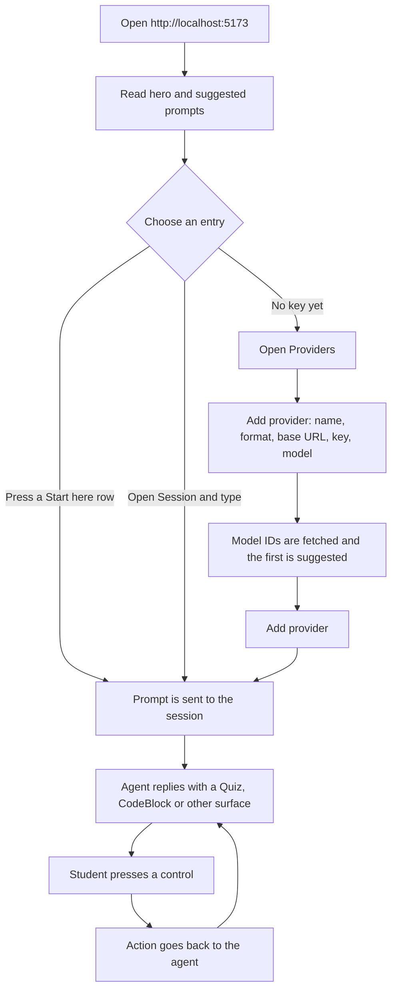
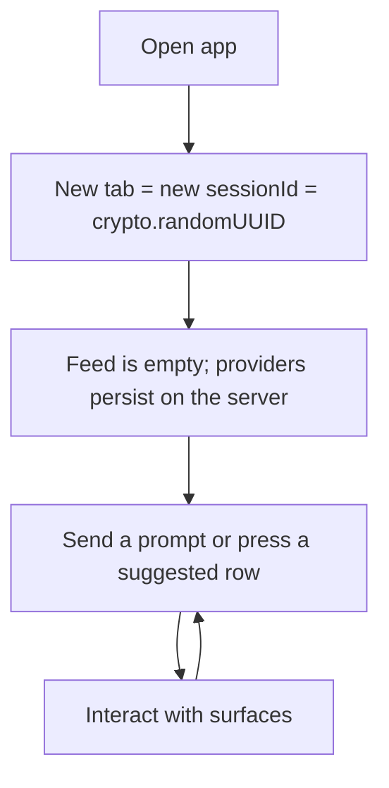
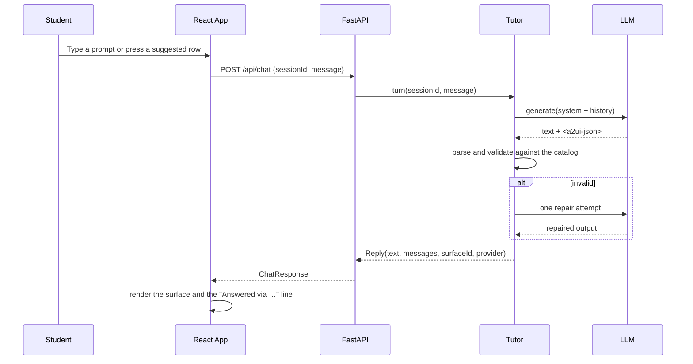
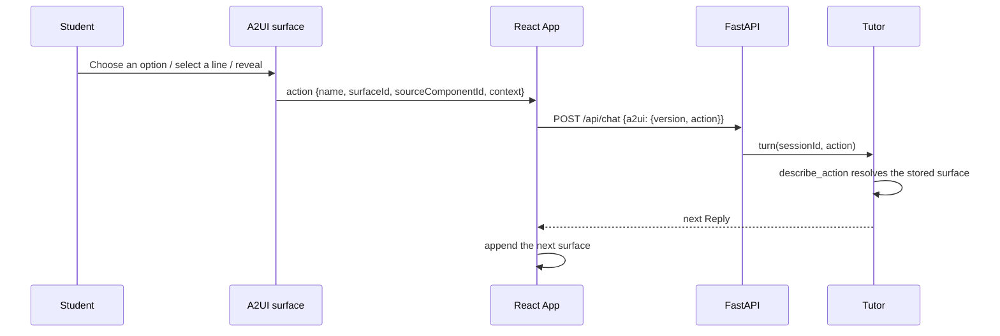
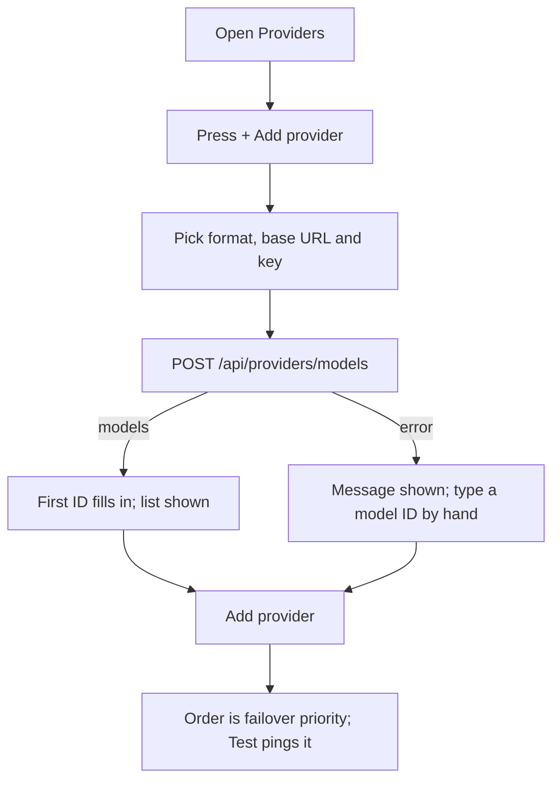

# User Journey & Application Flow — A2UI Tutor

## Application Screens

| Screen | URL | Purpose |
|--------|-----|---------|
| **Landing page** | `/` | Hero, suggested prompts, statement, live session, how a reply is built, FAQ, CTA, footer |
| **Session** | `/#session` | The feed and composer, inside the landing page |
| **Providers dialog** | Dialog on `/` | Add, edit, reorder, test and disable AI providers |
| **Mobile menu** | Drawer on `/` | Section links and the Providers entry below 1024px |
| **Not found** | `/404.html` | Static fallback page |
| **Photo credits** | `/credits.html` | Static asset and typeface credits |

Courses, a course browser and a progress view are **planned (P1)**. They do not exist in this build; the tutor is a
freeform session on one page.

---

## Navigation Structure

```
Header (fixed)
├── A2UI TUTOR wordmark → #top
├── Section links: Session · How a reply is built · Questions
├── Providers button → opens the providers dialog
└── Menu button (< 1024px) → full-screen drawer

Main
├── 01 Hero            → Start a session / How a reply is built
├── 02 Start here      → three prompt rows that send into the session
├── 03 Statement       → thesis band
├── 03 Session         → feed, composer, Configure, Clear
├── 04 Guardrails      → how a reply is built (isometric figure)
├── 05 Questions       → FAQ
└── CTA                → Bring your own model key

Footer
└── Sections · Setup · Assets · legal row
```

---

## First-Time User Journey



---

## Returning User Journey



There is no login and no saved conversation: closing or reloading the tab starts a fresh session. Provider settings
survive because they live in `agent/data/providers.json` on the server.

---

## Authentication Flow

**No authentication.** The app is designed for localhost. Anyone who can reach the port can read replies, change
providers and make the server call any base URL. Docker compose binds `127.0.0.1:8080`; never expose the API on a
public interface.

---

## Main Workflows

### Workflow 1: Prompt to surface



### Workflow 2: Surface press back to the agent



### Workflow 3: Add a provider



---

## Error & Edge Case Scenarios

| Scenario | System behavior |
|----------|----------------|
| LLM or provider failure | The chat request fails; the feed shows "Reply failed: …" with Retry |
| Invalid A2UI output after one repair | Plain-text fallback; no raw JSON is shown |
| No providers configured | The request fails and the feed offers Retry; add one in Providers |
| Provider key rejected | That provider sits out for 60 s and the next enabled one answers |
| Model list fetch fails | The form shows the error and still accepts a typed model ID |
| Network loss (web → API) | Fetch rejects; the error line and Retry appear |
| Tab reload | New session; provider settings remain |
| Action for an unknown surface | `describe_action()` returns a generic sentence; the agent still replies |
| Bad base URL | The server rejects it with 422 before any outbound call |

---

## Loading States

| State | Visual |
|-------|--------|
| Waiting for the agent | Three-bar skeleton, `aria-label="Waiting for the next surface"` |
| Surface rendering | Immediate, client-side |
| Model fetch in the provider form | "Fetching model IDs…" line |
| Provider test | Inline "✓ OK in 1.2s" or "✗ HTTP 401" note |

---

## Empty States

| Context | Message |
|---------|---------|
| Fresh session | "Nothing asked yet." plus a Write a prompt action |
| No providers | "No providers yet. Add one to start chatting." inside Providers |
| FAQ | Collapsed native `details` rows; no empty state needed |
| Static 404 | "This page has moved, or never existed." with links home and to the questions |
