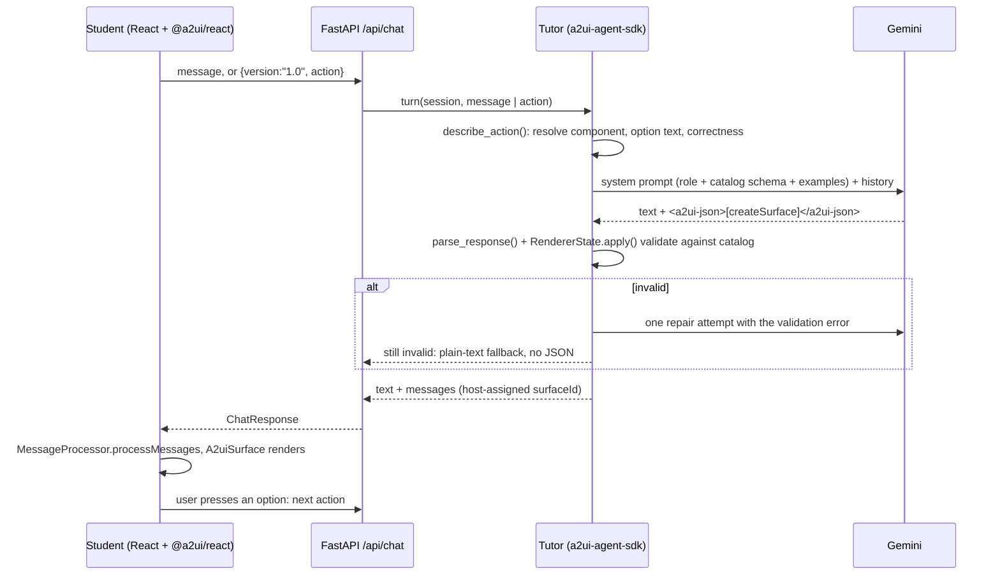

# Architecture

## Pieces

| Piece | File | Job |
| --- | --- | --- |
| Catalog source of truth | `agent/app/catalog/schemas.py`, `build.py` | JSON Schemas for the 5 custom components; derives the catalog from the SDK's v1.0 basic catalog and keeps only `Text`, `Row`, `Column`, `Divider`. Writes `tutor_catalog.json` to `agent/` and `web/src/catalog/`; CI fails if either copy is stale. |
| Prompt + validation | `agent/app/tutor.py` | `A2uiRequestProcessor` writes the schema and examples into the prompt and parses replies. A second pass applies every message to a `RendererState`, a mirror of the renderer. |
| Guardrails | `tutor.py` | Unknown components or properties, bad JSON, bad constraints and dangling children are rejected. One repair retry, then plain text. The host assigns `surfaceId`, never the model. LLM exceptions never crash the chat. |
| Providers | `agent/app/providers.py` | `ProviderStore` (JSON file, list order = priority), adapters for `openai`, `anthropic`, `gemini`, and `FailoverLLM` with a 60 s cooldown per failed provider. Errors keep only provider name and status code, never keys or bodies. |
| Server | `agent/app/main.py` | `POST /api/chat`: `{sessionId, message}` or `{sessionId, a2ui:{version, action}}`. |
| Renderer catalog | `web/src/catalog/` | React views registered with `createComponentImplementation`. Basic components come from `@a2ui/web_core`. |
| Chat shell | `web/src/App.tsx` | One `MessageProcessor` for the conversation. Its action listener posts the action to the server. |

## Action round trip

`Quiz` shows right/wrong instantly in the browser (it carries `correctIndex`), writes the choice to a bound path
(`setSelected`), then fires `onAnswer` on a microtask so the context binding `{"@path": "/answer"}` resolves to the
choice. The server turns the action into a sentence (`[action] quiz_answer: student chose option 1 ('[1, 2]'): CORRECT`)
using the component it stored for that surface, so the model never trusts client-side claims about correctness.
